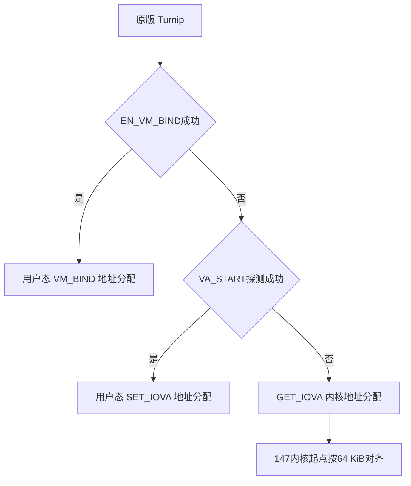

# A640 GPU 无 Mesa 本地补丁方案研究

用途：判断 Realme X2 Pro 的 CCU 翻译故障能否由内核长期处理，避免每次 Mesa 更新重新维护补丁。最后核对：2026-10-13，Asia/Shanghai。依据：阶段146至149的故障证据、校验过的 Mesa 26.2.4 官方源包、当前内核源码及本次原版驱动实机实验。

**可以做出不修改 Mesa 的内核兼容方案：同时拒绝 VM_BIND 启用和用户态地址分配能力探测，让原版 Turnip 回到 GET_IOVA，使用已有的内核 64 KiB 地址对齐修复。** 本机原版系统库已通过该路径的36次像素验证、23,921,097个像素读回，零差异、无新增GPU fault。限定本机的补丁已编译通过，尚未部署。

这个方案会失去稀疏绑定、地址捕获重放和部分内存管理优化。**如果要求保留全部 Vulkan 功能、完全不改变 Mesa 行为，并保证以后所有版本永久正常，现有证据无法支持这样的承诺。** 兼容方案与完整功能的根治需要分别验收。

后续功能用途与其他855机型比较见[同平台比较](peer-device-comparison.md)。源码复查发现MSRTSS可选多重采样扩展仍报告支持，但内部使用lazy内存路径；此前普通1x/4x MSAA测试没有覆盖该扩展。因此lazy BO关闭的影响还需专门验收，不能只归纳为内存开销。

## 故障的证据与范围

[阶段149故障分析](../kernel149/fault-analysis.json)记录：原版系统库与同构建基线均在第一次空洞用例绘制时失败。VM_BIND 调用全部成功，CCU 读取了颜色映射之前8192字节的地址；该地址等于BO起点向下取整到64 KiB，页表末级项为零。图像之前的小BO若没有释放，映射会掩盖问题。原版驱动的sysmem对照通过。

[阶段147](../../sessions/147-a640-gmem-alignment-fix.md)把A640内核管理的私有VM分配起点改成64 KiB对齐，修复了当时的GLES故障。Vulkan VM_BIND由用户态决定地址，绕过该分配器；[阶段149](../../sessions/149-vulkan-ccu-alignment-fix-and-deployment.md)因此又修改Turnip的自动地址分配。

目前能确认的是本机CCU访问与GPU虚拟地址布局的兼容问题。不能据此断定所有A640、所有颜色元数据访问都要求64 KiB，也不能直接称其为单一UBWC开关错误：[阶段146](../../sessions/146-gpu-gmem-isolation.md)的GLES实验中，noubwc、nobin、notile及flush仍失败，移动内核CCU invalidate事件也实际失败。后续调查应保留完整core、页表、映射和命令证据。

Mesa文档说明CCU参与GMEM向系统内存的resolve，这与捕获的故障来源一致，但该文档没有给出本机的64 KiB硬件勘误。[Mesa硬件架构说明](https://docs.mesa3d.org/drivers/freedreno.html#cache-hierarchy)

## 原版 Mesa 的三条地址路径

本次审查使用的源包SHA256与[Mesa 26.2.4官方发布说明](https://docs.mesa3d.org/relnotes/26.2.4.html)一致：`bce5f7fbebb934373b86c999a064d52fb5065878dc57f287f95346648ec832e9`。关键源文件逐字节匹配源包，校验记录在[compatibility-validation.json](compatibility-validation.json)。GitLab raw端点返回验证页，因此源码判断依据这个校验过的发布源包，未把验证页当作代码。

| 路径 | Mesa 26.2.4的选择条件 | 地址由谁决定 | 与现有修复的关系 |
| --- | --- | --- | --- |
| VM_BIND | EN_VM_BIND启用成功 | Turnip自动分配或显式指定 | 自动分配按os_page_size，本机为4096；绕过147分配器 |
| SET_IOVA | VM_BIND失败，但VA_START和VA_SIZE查询成功 | Turnip通过旧接口指定地址 | 仍然不能保证自动64 KiB对齐；147内核可能拒绝其指定范围 |
| GET_IOVA | VM_BIND失败，VA属性探测也失败 | 内核分配 | 使用147的A640 64 KiB对齐 |

关键位置是`src/freedreno/vulkan/tu_knl_drm_msm.cc`的`tu_knl_drm_msm_load`、`tu_drm_get_va_prop`、`tu_allocate_iova`和`tu_bo_init`。`has_vm_bind`与`has_set_iova`分别探测；拒绝前者不会自动清除后者。**只禁用VM_BIND并不能完成修复。**

Linux MSM的UAPI明确把VM_BIND模式的地址选择交给用户态。内核应按指定地址映射；它不能悄悄移动BO而继续返回成功，否则命令流和buffer device address仍引用原地址。[Linux MSM UAPI](https://github.com/torvalds/linux/blob/master/include/uapi/drm/msm_drm.h)

## 可执行的内核兼容方案

[a640-kernel-iova-compat.patch](a640-kernel-iova-compat.patch)是针对当前147源码的本地候选，依赖已有[内核64 KiB对齐补丁](../kernel147/a640-managed-iova-alignment.patch)。其策略只对`realme,samurai`且GPU为A640生效，避免把一台手机的证据直接扩大到其他型号。

1. `MSM_PARAM_EN_VM_BIND`返回`-EOPNOTSUPP`，阻止启用用户管理VM。
2. `MSM_PARAM_VA_START`返回`-EOPNOTSUPP`，让原版Mesa的VA属性探测失败，关闭`has_set_iova`。
3. 保留`MSM_PARAM_VA_SIZE`，因为Gallium用它限制显存预算；不用伪造GPU ID、DRM版本或地址范围。
4. 保留147的内核管理分配器与真实映射长度。地址间隙只消耗虚拟地址，不额外映射物理页。

这不是动态模块开关，候选需要完整构建、部署新内核后才会对普通进程生效。当前源码没有现成参数可直接替代这些行为。只添加一个新的“对齐要求”内核查询也不足以影响当前Mesa：用户态必须实际读取并遵守它。

候选已在副本中通过`git apply --check`，使用当前内核保存的真实交叉编译命令编译`adreno_gpu.o`，追加`-Werror`等检查，编译日志为空。`checkpatch --no-tree --no-signoff`为0错误、0警告。本地研究候选没有代签DCO；还不是已经提交上游的补丁。[编译收据](kernel-candidate-validation.json)

当前主内核源码保持原样。未完整构建Image/modules/DTB，未刷写或重启，也未回退系统Mesa149库。实验通过不能代替候选内核部署后的验证。

## 原版驱动实机验证

实验通过独立进程的`LD_PRELOAD`只模拟两次可选能力探测失败。没有改Mesa源码、系统库、GPU地址或成功映射请求；实际BO分配和绘制仍由原版驱动与当前147内核完成。ICD指向阶段149保存的原版系统库，SHA256为`c72f5ee34e9f4fcf200e4987285f6fdfef4442fd146b77a4c0d1cbf5d5525955`。

| 实验 | 结果 | 证据意义 |
| --- | --- | --- |
| 只拒绝EN_VM_BIND的能力查询 | 初始化成功，地址capture/replay仍为1 | 验证还有SET_IOVA路径；未用这一路径重复故障绘制 |
| 同时拒绝VA_START的能力查询 | 初始化成功，普通BDA为1，capture/replay为0 | 验证原版Mesa接受能力降级 |
| 强制GMEM、图像前方释放小BO | 18次、12,909,717像素，零差异 | 183次GET_IOVA全部64 KiB对齐；VM_BIND及SET_IOVA调用均0 |
| 图像绑定到4 KiB、8 KiB、60 KiB偏移 | 每种6次，共11,011,380像素，零差异 | 验证合法非零image memoryOffset，不能只测试BO起点 |
| 非零偏移前方哨兵数据 | 检查663,552字节，零改写 | 有映射的前方区域在这些用例中没有被破坏 |

图像子分配遵守驱动实际报告的4096字节alignment，覆盖RGBA8、BGRA8 sRGB、RGBA16F及1x/4x MSAA。Vulkan规范允许符合资源alignment的非零memoryOffset，因此BO起点和图像起点必须区分；本次覆盖了三个具体偏移，不能扩展成全部资源布局验收。[Khronos内存需求](https://docs.vulkan.org/refpages/latest/refpages/source/VkMemoryRequirements.html)、[图像绑定规则](https://docs.vulkan.org/refpages/latest/refpages/source/vkBindImageMemory.html)

两组绘制结束后分别观察60秒。累计fault保持3，新增0；WARN、DPU timeout、DSI error、DMA prepare保持0，taint0，启动保持，首组验证桌面进程保持，收尾确认物理Phoc/Phosh存在。没有待取core和活动测试进程。[主验证](compatibility-validation.json)、[子分配验证](suballocation-validation.json)、[收尾](closeout.json)

首组汇总工具曾误用`PIXEL_RESULT`匹配实际`PIXEL iteration=`，导致行数显示0；已从完整原日志修正为18，没有重复已通过的负载。GPU返回结果和逐像素差异始终为零。

## 功能与维护代价

能力降级后，原版26.2.4的`sparseBinding`为0，`bufferDeviceAddressCaptureReplay`为0，普通`bufferDeviceAddress`仍为1。地址重放功能及依赖用户态地址空间的lazy BO路径也受影响。需要这些能力的应用不能当作透明兼容；CPU提交开销、内存压力和性能需要实测，不能用本次像素结果推算。

能力查询还有一个值得保留的现象：`sparseResidencyBuffer`仍报告1，而`sparseBinding`为0。因此不应写成“所有稀疏feature都会自动变0”，也不能声称该降级配置已经通过完整Vulkan CTS。

64 KiB起点对齐会增加虚拟地址空隙；本机A640还有4 GiB地址空间限制，应覆盖BO碎片化与高内存压力。DMA-BUF导入导出、外部同步、GTK实际桌面、多进程、长期运行、重启和PM也需要在候选内核上验收。首组有1.1秒绘制间隔，但未采集PM事件计数，不能把间隔等同于已经验证了挂起恢复。

Mesa普通包更新不会覆盖内核中的兼容策略，因此比替换一个本地`.so`更容易持久维护。不过未来Mesa若取消GET_IOVA后端或改变能力探测，仍需重新评估；内核更新也必须携带该策略。它不能保证所有未来版本永久兼容。

## 其他路线的判断

| 路线 | 判断 |
| --- | --- |
| 保留完整功能并使用正式Mesa软件包 | 推动对齐规则进入Mesa上游与发行版，是避免维护本地Mesa补丁的完整功能路线；仍需用户态配合 |
| 完全不改Mesa，只改内核 | 上述兼容候选有原版驱动实证，功能会降级；优先做完整构建与真实部署验收 |
| 在VM_BIND映射时偷偷round up或round down地址 | 破坏显式地址、BDA、稀疏偏移及capture/replay语义，不能采用 |
| 强制每个VM_BIND地址64 KiB对齐，不提供回退 | 原版Mesa仍提交4 KiB对齐地址，结果会变成映射失败，不会自动修好 |
| 将空洞映射为零页或复用邻页 | 掩盖访问错误，可能破坏别名和数据正确性；不能当作根治 |
| 改IOMMU页大小或DMA掩码 | 不会自动改变os_page_size及用户态地址选择，不能替代分配合同 |
| 全系统改64 KiB页面 | 技术上可能影响Mesa自动分配粒度，但属于内核、ELF、rootfs及二进制兼容的整体迁移，当前未验收 |
| DT填一个对齐属性 | 当前分配路径没有相应读取机制，仅改DT不能改变Mesa行为 |
| 换KGSL或更新固件 | 当前证据没有证明可以直接修复；KGSL不是MSM用户态ABI的即插即用替换 |
| 强制sysmem | 可作诊断和救援策略，避免部分GMEM路径，但不修复地址合同 |
| 关闭UBWC或调整CCU事件顺序 | 旧GLES实机已经失败，不能重复当成已证实方案 |

已检索的官方发布说明、Linux UAPI和Freedreno资料没有提供经过本机验证、可保留全部功能的纯内核勘误修复。这个检索范围不代表穷尽全部未合并讨论，也不保证Mesa最新main没有相关工作。

## 后续落地与完整功能根治

对当前手机，先把兼容候选与147的对齐修改一起完整构建。在恢复原版Mesa之前，部署候选内核并确认两项能力拒绝及GET_IOVA的真实结果，再用原版驱动完成空洞、默认自动调优、GTK、GLES并发、DMA-BUF、PM及重启回归。通过之后将内核补丁纳入可复现的发行构建及新rootfs，才可取消Mesa本地库替换。不能先移除149库补丁再用现有内核启动普通Vulkan进程。

若要保留VM_BIND及capture/replay，应向上游提供脱敏最小复现、完整故障映射关系，以及原版失败和对齐通过的对照，讨论A640勘误和分配合同。重点覆盖自动BO起点、合法图像子分配、显式重放、稀疏部分映射、DMA-BUF及4 GiB虚拟地址压力。硬件寄存器或固件层若有可证明的修复，还需按本机硬件版本验证；在取得证据前，不能用推测的寄存器值代替用户态合同修复。

原始日志、运行源码和库保存在手机`/var/lib/samurai/k150-research`，归档在手机`/var/lib/samurai/k150-research-private.tar.gz`及主机`E:/edk2-samurai-out/kernel150`。这些文件含原始地址和启动身份，仅保留本地；文档目录保存脱敏收据与候选代码。
