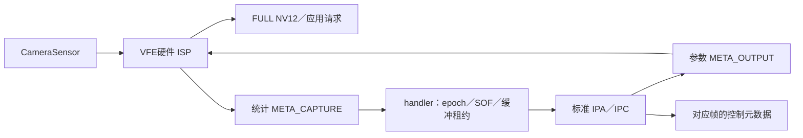

# 300：CAMSS 硬件 IPA 模块与生命周期收敛

2026-10-19。实际设备仍运行 **#298／778模块**，boot276、DTB、原厂固件和产品相机包保持；没有刷写或重启。本阶段在私人目录验证候选库，正式应用仍使用原RAW＋CPU ISP。完整多摄校准目标继续，不能把手动IPA接通当作自动算法或完整IQ完成。

## 实现与分层

新增标准 `camss.mojom`、IPA模块和自动生成的代理／worker；复用libcamera既有IPABuffer、SharedFD、MappedFrameBuffer、ControlList、IPC和libipa V4L2Params。调校文件解析、56字节参数编码、BHIST检查和逻辑ColourGains元数据移入IPA；handler不再解析YAML、编码ISP参数或解码统计。

handler只管理媒体图、格式、缓冲、参数回执、原始SOF和请求生命周期；参数与统计FD通过标准IPA接口传递。每个启动有独立epoch，参数完成报告首个生效SOF，统计解码完成才归还对应缓冲。启动统计先等待参数回执，旧epoch或不匹配的租约回调不重入新队列。缺失统计的图像仍有有界完成路径，但完整故障／取消／严重IRQ延迟验收尚未完成。

IPA按完整头、精确长度、类型／flags、ROI人口、单调SOF检查统计；错误包不消耗下一有效SOF，也不输出已生效控制元数据。ColourGains是用户请求的逻辑启动增益，**不是本机标定值或硬件量化精度证明**。当前BHIST仍为BLS后／WB前的线性Y统计，不能替代RGB AWB数据。

SoC驱动／板级／内核均沿用298，本轮不增加DT属性、私有ioctl或内核补丁；配置和算法收敛在用户空间。输入仍限定已实现的Bayer10、单NV12流，当前实机范围仅IMX319的1632×1224输入和320×240输出。逐请求控制仍明确拒绝；sensor helper、DelayedControls、实测延迟、AE／AWB和其它摄像头模式尚未接入或验收。

## 构建与协议证据

- [构建](build-validation.json)：真实0.7.2/r24 SDK、模块、生成接口／代理／worker均Werror通过。仅修改隔离候选树 `/home/cy122/x2pro-linux/libcamera214-root/work/libcamera299-inline`；其目录名称沿用299，但内容现为300候选，勿重放299构建脚本覆盖。
- [真实DSO契约](ipa-contract-validation.json)：AArch64直接加载实际模块，56字节包与独立C结构参考逐字节一致、尾部不改；覆盖重复／旧SOF、旧epoch、错误长度／头／flags／角色／人口、非有限增益、stop／重开和32位SOF回绕。此项不是物理或IPC测试。
- [8文件候选包](ipa-bundle-r4-validation.json)：标准模块、签名、worker、两库和测试程序／配置；不包含签名私钥、不替换系统库。299已测源码私下归档、旧手动候选包保留。[保留事实](baseline-preservation-validation.json)

## 实机验证

[最终独立交叉核对](runtime-association-validation.json) 对R4／R5原始私有日志重新关联应用请求、ColourGains元数据、图像／统计原始SOF、IPA实际解码事件和参数回执，并读回手机上全部8个包文件核对SHA。

| 模式 | 实机结果 | 进程／生命周期 | 收尾 |
| --- | --- | --- | --- |
| 默认签名加载 R4 | 三轮各24帧；72图像／统计／SOF／元数据对应 | 签名被标准管理器接受；IPA与应用同PID，不同线程；只init一次 | 媒体图恢复、1306ms自然休眠 |
| 强制隔离 R5 | 三轮各24帧；72图像／统计／SOF／元数据对应 | 应用PID18695、IPA18700；标准IPC，亦只init一次 | 媒体图恢复、1298ms自然休眠，无匹配活worker |

两模式参数均从每轮SOF0生效。144帧均通过CPU DMA同步读取检查且亮度非恒定；没有将RAW图像交给CPU ISP。测试使用原厂BLS显式参考配置和前阶段临时场景WB，传感器／CSID图案保持关闭；这些结果证明手动硬件IPA路径，不能证明色彩准确度、AE／AWB或全部摄像头可用。[R4](ipa-capture-r4-validation.json)、[R5](ipa-capture-r5-validation.json)

## 失败、修复与恢复

1. Meson保留旧选项choices，首次添加IPA选项被拒绝；先刷新配置后启用。另按实际版本改用IPACameraSensorInfo.bitsPerPixel，保留失败日志。
2. R1隔离模式72帧通过。R2把强制隔离变量设为0仍被强制隔离；该变量按存在性生效，默认模式必须从子进程环境移除。R2派生报告已按日志纠正实际隔离标志，原始私有报告保留，未当默认模式通过。
3. R3默认模式签名加载和第一轮24帧成功，第二次init触发用户空间线程归属断言。修为每个代理仅init一次，停流重开调用configure/start；release销毁代理，重新acquire可重新选择配置。同一次acquire中变更配置路径会显式拒绝。
4. R3异常退出使旧测试fixture先恢复主摄输入链接时与仍启用的输入竞争，留下一条原始链接关闭。核对实际图和保存的前后图后，只通过标准MC接口恢复该链接，并读回完全一致；没有重启、强制挂起或改内核。[恢复收据](graph-recovery-validation.json)
5. 新fixture先恢复全部禁用边，再恢复启用边，原299工具保留。[工具](fixture-validation.json) 修正后R4／R5通过。主动异常注入和更广的故障／取消矩阵仍未完成，不能把正常收尾结果扩大为所有异常路径已验收。

R3为测试应用SIGABRT，内核未新增WARNING／Oops／CCI错误。最终5传感器／镜头、两CCI、CAMSS休眠，9相机供电和共享IO关闭／用户0，MCLK／CCI时钟0，taint／pstore为0；961包、50相机载荷、778模块核对保持。桌面／PipeWire／WirePlumber原PID、SensorProxy、Wi-Fi／HCI及三个DSP保持正常。[最终检查](final-health-validation.json) 四摄产品回归引用298原结果，本轮没有重跑或将候选结果当成产品包升级验收；whole_system_healthy=false保留。

## 剩余目标

先验证晚启动统计、丢失SOF、逐帧参数与取消／worker故障，再复用sensor helper／DelayedControls测定并表达曝光、增益延迟，接AE和有效颜色统计／AWB，扩展其它摄像头与模式。全局色彩、镜头阴影、对焦及完整IQ仍未校准；S5K3M5注册时的crop bounds／静态属性缺口仍开放。

原厂BLS与本机EEPROM维持[299的数据边界](../kernel299/README.md)：通用参考与个体数据分开，EEPROM完整格式／校验未核实、未应用个体值；用户暂不遮光，不能把正常场景拟合冒充暗场标定。没有上游接受或跨版本迁移证明，仍不能承诺零补丁升级。

私人产物 `E:/edk2-samurai-out/kernel300`。R1—R5已核终态，失败与恢复记录保留；不盲目重放启动／采集／恢复脚本。当前guard仍为298；稳定回退仍为290。完整目标未完成。
