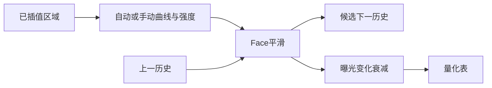

# 408：恢复本机 Face 平滑状态，接入完整曲线阶段顺序

从本机原HAL恢复日志名为 `SmoothingForFace` 的LTM处理块，新增[显式状态实现](libipa/ltm_face_smoothing.cpp)，并接到407曲线生成与曝光衰减之间。3931项有效用例／47项非法输入，以及旧接口6630条记录，在主机和AArch64对照通过。**本轮完成该曲线阶段的数学和状态适配；ADRC、动态触发树、剩余LTM参数及产品接入仍未完成。完整多摄／ISP目标继续active。** 本轮未访问手机，没有新硬件帧；最后实机仍为[406](../kernel406/current-state-validation.json)。

## 现有方案与目标证据

复用407通用曲线和351原厂2135区域，定点检查现有固定CamxChi仓库的三个输入类型声明，没有另取整包固件。[来源](primary-sources.json)。较新参考源码没有本机这段Face平滑，不能直接把407源码的自动／手动处理等同于本机全部曲线流程。

实际原HAL `0x35ea60…0x35ea94` 将输入结构首指针所指对象的124字节值复制到LTM对象448，节点是否为 `0x10003` 的判断复制到452，原输入140字节值复制到456。目标日志字符串为 `SmoothingForFace`；452对应BPS节点判断。较新输入声明可帮助追踪AEC来源，但目标124／140字段的完整上游标签名尚未证明，API保留显式信号与原始门控值，没有猜作某个HDR／闪光／视频选项。

实际 `0x360560…0x360ac8` 证明：BPS或原140字段**恰好等于1**时，跳过这段平滑和历史更新；其它值不自动等同于TRUE。非跳过时，输入信号大于0与否构成状态；正／非正状态切换将剩余更新数重置为90。当计数非零，99个曲线浮点值逐项执行 `previous + (current - previous) * 0.05`，计数减1；随后保存曲线历史。计数为0时直接保存新曲线。这里计数是执行该计算的次数，不能未经触发条件核对就当成相机帧数。

原始实现把历史和计数保存在HAL全局内存。新API明确传入上一状态并返回候选下一状态，方便未来由各流水线拥有、在适当的请求阶段提交；没有声称复现多个HAL对象共享全局变量的整个生命周期，也没有默认开启该功能。

## 正确的阶段顺序

历史必须在曝光衰减**之前**保存。407原组合接口保留行为，新加[准备与衰减两个阶段](../kernel407/libipa/ltm_curves.h)，供408按本机顺序插入平滑；没有通过除以曝光系数来倒推未衰减值。具体检查中，历史100、新强度曲线−100、0.05过渡得到历史90，再经0.5衰减输出45；正负LCE分别保存±52.5、输出±26.25。[API检查](api-validation.json)。

平滑中的乘法与加法分别舍入。代码在中间值保留舍入边界，主机和AArch64使用 `-ffp-contract=fast` 构建仍与目标的FSUB／FMUL／FADD序列零差。无效输入、空输出和状态／输出别名保持所有输出不变；输入状态不能与候选下一状态原地重用。是否提交候选状态仍属于后续请求生命周期接入。

## 验证范围

[原HAL对照](temporal-validation.json)实际执行平滑片段，以及不再跳过平滑的 `0x35ec64…0x360c3c` 曲线阶段，累计4161408条指令。3931个有效用例包括500个直接边界／随机状态、全部2135个原厂区域、96个自动曲线、五份模组配置各240次连续更新。327次跳过保持状态，1218次重置过渡，3099次实际过滤；2062次明确观察到保存历史与衰减输出不同。所有序列都在离线模拟器中执行，不是手机采集。

主机ASan／UBSan和AArch64 SDK／QEMU，对比输出曲线、状态、量化表及非法输入保持，共4741776字节逐字节零差。拆分后的407原组合接口也与保存的6630条结果、5224440字节完全一致。[最终接口检查](api-validation.json)再次用当前源码对保存的3978条新记录核对，并检查上述明确数值和拒绝别名契约。

原HAL的12480次powf仍由主机libm提供，3604次memcpy由内存复制provider执行；数学、状态切换、过滤和历史更新均为原指令。本轮未执行原HAL最终LUT打包区段，量化沿用407已验证的源规则；未把这段曲线流程称为整个LTM Execute、整固件或手机硬件调校通过。

[初始模型失败](model-r1-validation.json)保留：在3631项完成后，从长执行区间切回短区间时，Unicorn缓存的翻译块跨过短终点，误入下游日志provider。模型增加指令钩子的显式终点停止，未修改原HAL指令或数学；失败输入及信息私存。修正模型后完整检查通过，这不是手机或内核故障。

## 接续与状态

本轮只改可移植用户空间数学和验证，内核源码仍为406 `samurai-ipe-full-pass-ip406`／`b4f382affa9a8be089ccec6170c34d74005103ce`，干净未永久安装。[源码状态](source-state.json)。板级DT、传感器、主线框架、DMA／所有权、产品IPA和默认参数未改，406的显式IP启用修正继续保留。

下一步继续ADRC和DRC／HDR／AEC触发树，补LA／mask／权重／标量与逆Gamma组合，明确原124／140字段来源、触发重算条件和IFE／IPE输入域；再接请求状态提交、非零LTM实像素／统计／连续参数及恢复，接标准media request／libcamera。[363全部剩余范围](../kernel363/REMAINING-CAMERA-SCOPE.md)仍包括第五2MP身份／mux、多模式、防频闪、连续AF／光学及多摄几何同步。

最后设备证据仍是406修正固定52请求、正式395／393恢复四摄48帧及资源释放。407、408均没有新手机事务，不能重复计数。原厂代码／表、ASM、参考样本和日志私存kernel408及前序；公共代码及检查点只本地提交，不push／PR。
